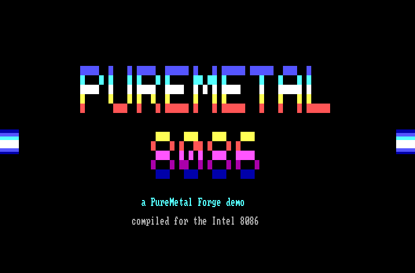
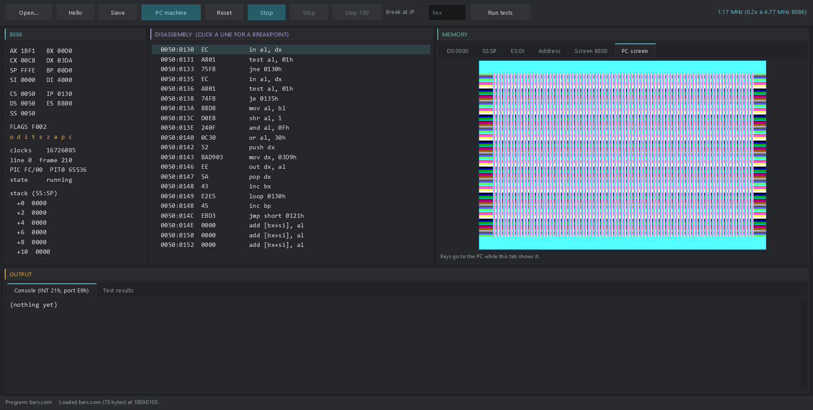

# PureMetal 8086 for the Raspberry Pi Pico series

An Intel 8086 emulator for the Raspberry Pi Pico W (RP2040) and Pico 2 W (RP2350), written in
PureMetal and compiled with PureMetal Forge to bare-metal machine code: no SDK, no RTOS. It is a
complete, cycle-counted 8086 core that passes all 646,000 SingleStepTests reference tests on the
physical boards, and around it a small IBM PC (CGA graphics, 8253 timer, 8259 interrupt controller,
keyboard) that runs .COM programs in real time on a 480 x 320 SPI panel. The same core, generated
from the same source, also runs as a Windows program with a debugger-style window.

**No BIOS, DOS or other copyrighted ROM is needed or included.** The PC machine starts a .COM
program directly; every program in this repository was written for it (most of them in PureMetal).



## Highlights

- The whole 8086 instruction set as the real chip behaves, undocumented flags and aliases included;
  646,000 of 646,000 SingleStepTests 8086 reference tests on the Pico W, the Pico 2 W and the PC.
- Fast: computed-goto dispatch from SRAM, lazy flags, host-pointer instruction fetch. On the Pico 2 W
  the hottest handlers are hand-written Thumb-2: up to **5.9 M 8086 instructions a second** at
  150 MHz (a 4.77 MHz IBM PC does well under one million).
- Counts real 8086 clocks when asked, so a PC machine around it keeps NTSC time: 262 scanlines of
  304 clocks, **59.92 frames a second**, on the panel.
- **Both cores work**: core 0 runs the PC, core 1 draws each scanline from the CGA memory and drives
  the panel by DMA. Raster effects (colour changes in the horizontal blank) are exact to the line.
- A documented core API: memory pages (RAM, ROM, unmapped, hooks), port hooks, interrupt and NMI
  lines, a run-for-N budget in instructions or clocks.
- A Windows version on the Neon Arcade Display Engine: registers, flags, disassembly, memory and CGA
  views, breakpoints, run/step, the PC screen with sound, and command-line runners for automated tests.

## Download

Ready images are in [`firmware/`](firmware/). Hold BOOTSEL, plug the board in, and drag the `.uf2`
onto the drive that appears.

| Image | Board | What it does | Tested |
|---|---|---|---|
| `8086-pc-demo-picow.uf2` | Pico W | the PC machine running the PureMetal demo (raster bars, plasma, copper) | on a Pico W with the LAFVIN panel |
| `8086-pc-demo-pico2w.uf2` | Pico 2 W | the same, Thumb-2 core | on a Pico 2 W with the LAFVIN panel |
| `8086-pc-picow.uf2` / `8086-pc-pico2w.uf2` | Pico W / Pico 2 W | the PC machine running `bars.com` (a small raster test) | Pico W on the board; Pico 2 W built from the same sources |
| `8086-picow.uf2` / `8086-pico2w.uf2` | Pico W / Pico 2 W | the bare core: self-test, `sieve.com`, then its speed, once a second, on USB serial | on both boards |

## Hardware

| | Pico W (RP2040, 200 MHz) | Pico 2 W (RP2350, 150 MHz) |
|---|---|---|
| Core | Thumb-1, computed goto from SRAM | the same, plus hand-written Thumb-2 hot paths |
| PC machine guest RAM | 126 KB | 352 KB |
| Display | LAFVIN ST7796 480 x 320 SPI panel: SCK GP2, MOSI GP3, CS GP5, DC GP6, RST GP7 | the same wiring |
| Keyboard | USB serial: what you type becomes PC scan codes | the same |
| Sound | the PC speaker is emulated (port 61h, PIT channel 2) but not played on the Pico | the same |

The PC picture is 320 x 200 on the panel (the CGA's 640-pixel modes are shown at half width),
centred. Any ST7796 panel wired as above works; the core itself needs no display at all.

## Getting started: the PC machine on a Pico

1. Flash `firmware/8086-pc-demo-picow.uf2` (or the `pico2w` one) as above.
2. Open the board's USB serial port (115200 baud, any terminal). The demo starts as soon as the port
   is opened, or after 10 seconds without one.
3. Watch the panel. Once a second the board prints a status line: frames, 8086 clocks a second
   (4.77 M is real time), CS:IP, the CGA mode and what each core is doing.
4. Type: letters, digits, space, Enter, Esc and Backspace reach the PC as set-1 scan codes (make,
   then break).

To run a program of your own, see [Running your own program](#running-your-own-program).

## The PC machine

A minimal IBM PC without a BIOS (`src/pc86.pmi`, shared by the Pico and the desktop):

| Ports | Device |
|---|---|
| 20h-21h | 8259 PIC (ICW1-ICW4, mask, EOI, IRR/ISR read); starts as a BIOS leaves it: vectors at 8, IRQ0 and IRQ1 open |
| 40h-43h | 8253 PIT, channels 0-2, modes 0-5; channel 0 is IRQ0 at 18.2 Hz from reset, channel 2 the speaker |
| 60h, 61h | keyboard (set-1 scan codes, IRQ1, acknowledge on 61h bit 7); speaker gate and data |
| 3D4h/3D5h, 3D8h, 3D9h, 3DAh | CGA: 6845 start address and cursor, mode, colour select, status (display enable and vertical retrace, timed from the CPU clock) |
| E9h out | a byte to the console (USB serial on the Pico, stdout on the desktop) |
| F4h out | ends the program; the value is its exit code |

CGA modes: text 40 x 25 and 80 x 25 (16 colours, blink or bright backgrounds, cursor), 320 x 200 in
four colours with both palettes, and 640 x 200 in two. Mode, colour select and start address are
taken at the start of each scanline, so a change made in the horizontal blank shows from the next
line. A program loads at 0050:0100 with CS = DS = ES = SS = 0050 and SP = FFFE, and sets up its own
interrupt vectors. Full details: [`desktop/README.md`](desktop/README.md#the-pc-machine).

## Running your own program

Any .COM that drives the hardware directly (no BIOS or DOS calls) runs on the PC machine.

On the desktop:

```text
desktop\cpu86_desktop.exe program.com --pc --run          the window, with sound (--mute for none)
desktop\cpu86_pc.exe --com program.com --pc --frames 600  headless; --screenshot shot.png
```

On a Pico, the program is built into the firmware:

```powershell
py -3 tools/make_pcprogram.py path\to\program.com           # writes src/pcprogram.pmi
.\tools\build.ps1 -Source src/pc.picow  -Output my-pc.uf2   # Pico W   (src/pc.pico2w for the Pico 2 W)
```

`demo/` holds the PureMetal demo's source (`demo.pc8086`), written for this machine and compiled by
PureMetal Forge's 8086 back end, as an example of a program written for it.

## The desktop version (Windows)

`desktop/` has ready-built x64 programs:

| Program | Use |
|---|---|
| `cpu86_desktop.exe` | the window: registers, flags, disassembly with breakpoints, memory and CGA views, run/step, the PC screen with sound |
| `cpu86_pc.exe` | the PC machine without a window (`--com x --pc`, `--frames`, `--keys`, `--screenshot`, `--portlog`, `--halfcheck`) |
| `cpu86_run.exe` | a bare CPU for automated tests: `--com` / `--raw`, `--max`, `--dump`, OUT E9h to stdout, OUT F4h to exit; `--test`, `--bench` |
| `cpu86_console.exe` | the same console modes with the window's code linked |

The PureMetal demo in the window: `desktop\cpu86_desktop.exe demo\demo.com --pc --run` (from the
repository folder). See [`desktop/README.md`](desktop/README.md) for every option.



## Performance

All figures are from the physical boards.

**The core**, 1,000,000 8086 instructions per sample, counting instructions:

| Mix | Pico W, 200 MHz | Pico 2 W, 150 MHz (Thumb-2) | Desktop (x64) |
|---|---:|---:|---:|
| register / branch (`DEC CX` / `JNZ`) | 4.60 M instr/s | 5.88 M | 444 M |
| ALU on registers | 2.41 M | 3.57 M | 490 M |
| memory (`[SI]`, `[DI+2]`, immediates) | 1.83 M | 1.71 M | 232 M |
| call / stack | 2.47 M | 3.31 M | 348 M |
| `REP MOVSW` | 9.47 MB/s | 8.71 MB/s | 771 MB/s |

**The PC machine at 60 frames a second**, share of each core per second of real time (core 0: the
8086 and the devices; core 1: drawing the lines):

| Program | Pico W core 0 / core 1 | Pico 2 W core 0 / core 1 |
|---|---:|---:|
| demo title, 80 x 25 text, raster bars | 52% / 63% | 49% / 62% |
| demo plasma, 40 x 25 text | 42% / 43% | 39% / 44% |
| demo copper, 320 x 200 | 53% / 50% | 50% / 51% |
| 80 x 25 text, CPU idle | 11% / 59% | 12% / 58% |

Every mode runs at the real 4.77 MHz. The one case measured below it is 80-column text whose colour
attribute changes in nearly every cell (93% on the Pico W).

## Testing

| Check | Pico W | Pico 2 W | Desktop |
|---|---|---|---|
| SingleStepTests 8086 v1, every test of all 323 files | 646,000 / 646,000 | 646,000 / 646,000 | 646,000 / 646,000 |
| the same, 100 per file, clock-counted and plain-tail builds | 32,300 / 32,300 each | 32,300 / 32,300 each | |
| API, interrupt and memory-map checks (`Diagnostics/api_body.pmi`) | 78 / 78, 77 / 77 | 78 / 78, 77 / 77 | 78 / 78 |
| PC machine: timer and retrace (`pctest`), keyboard (`keytest`), every CGA mode (`modes`), REP under interrupts (`reptest`) | pass | pass | pass |

The reference tests are streamed to the board over USB, and the board checks each one itself: all
registers, FLAGS (under the published mask of undefined bits), and every byte of memory touched.
The corpus is not stored here; `py -3 tools/fetch_tests.py` downloads the pinned version (about
180 MB), and `tools/vectors.py --port COMx` streams it after you flash `Diagnostics/vectors.picow`
(or `.pico2w`). Logs of the runs are in `docs/`.

## Building from source

### The Pico firmware

You need **PureMetal Forge** (compiler build of 2026-10-25 or later) and Python 3.

```powershell
$env:PUREMETALFORGE = 'C:\path\to\PureMetalForge.exe'
.\tools\build.ps1 -Source src/pc.picow    -Output firmware/8086-pc-picow.uf2     # add -Port COMx to upload
.\tools\build.ps1 -Source src/pc.pico2w   -Output firmware/8086-pc-pico2w.uf2
.\tools\build.ps1 -Source src/demo.picow  -Output firmware/8086-picow.uf2
```

The cores are generated: `py -3 tools/gen_cpu.py` writes `src/cpu86.pico` (RP2040),
`src/cpu86.pico2` (RP2350) and `desktop/cpu86_core.pbi` from one description of the handlers;
edit the generator, not its output (the generated files are committed, so a build does not need
Python). `build.ps1` refuses an image that would reach flash offset `0x50000` (the boards this was
developed on keep other data there). `tools/board.ps1` batches board runs on the development bench
and is specific to it.

### The desktop version

You need **PureBasic 6.41 x64** (C back end, `pbcompilerc.exe`; built and tested with 6.41) and the
[Neon Arcade Display Engine](https://github.com/ajtaji/Neon-Arcade-Dispay-Engine), cloned **beside**
this repository (the source looks for `../../Neon-Arcade-Dispay-Engine/` relative to `desktop/`):

```powershell
git clone https://github.com/ajtaji/8086EmulatorPicoSeries.git
git clone https://github.com/ajtaji/Neon-Arcade-Dispay-Engine.git
cd 8086EmulatorPicoSeries
& "C:\Program Files\PureBasic\Compilers\pbcompilerc.exe" desktop\cpu86_desktop.pb /EXE desktop\cpu86_desktop.exe /THREAD /DPIAWARE /OPTIMIZER /CONSTANT CPU_TIMING=1
& "C:\Program Files\PureBasic\Compilers\pbcompilerc.exe" desktop\cpu86_desktop.pb /EXE desktop\cpu86_pc.exe /CONSOLE /THREAD /DPIAWARE /OPTIMIZER /CONSTANT CPU_TIMING=1
& "C:\Program Files\PureBasic\Compilers\pbcompilerc.exe" desktop\cpu86_desktop.pb /EXE desktop\cpu86_run.exe /CONSOLE /THREAD /OPTIMIZER /CONSTANT CPU86_LEAN=1
```

The first line is the window, the second the PC machine without a window, the third the bare-CPU
test runner (it needs no engine). Run the PureMetal demo in the window:

```powershell
.\desktop\cpu86_desktop.exe demo\demo.com --pc --run
```

The engine can live elsewhere: add `/CONSTANT GL_ENGINE_DIR$=C:\path\to\engine\` (with the
trailing backslash). `desktop\build.ps1` does all of this at once (and regenerates the cores
first, which needs Python): it takes the engine from `NEON_ENGINE`, or the clone beside the
repository.

## How it works

**Dispatch.** `Cpu86Run` runs from SRAM. Every handler ends with its own jump through a 256-entry
table (`.Label` addresses), so there is no call or return per instruction. The instruction pointer
is a host pointer into a fetch window, the current 4 KB page cut short so that any instruction
starting in it lies wholly inside it; an instruction that crosses a page or the 64 KB wrap is copied
to a small buffer first.

**Registers.** Six reserved ARM registers hold the hot state for the whole program: r4 the
instruction pointer, r6 the budget, r8/r9/r10 the flag words, r11 the window's end. PureMetal checks
every library and inline-assembly block against the reservation.

**Flags.** Kept lazily: the sign-extended result (ZF, SF, PF are derived from it on demand), carry
and overflow in bit 31 of their own words, AF from the operands' XOR.

**Memory.** 256 pages of 4 KB, each RAM, ROM, unmapped or a hook page. Two tables hold a host pointer
per page, pre-offset so that an ordinary access is one load; everything unusual (ROM writes, hooks, a
word across a page or segment end) takes the slow path.

**Timing.** With `#CPU_TIMING = 1` each instruction charges its 8086 clock count from Intel's tables
(base plus effective-address time). A REP string instruction stops between elements when the
budget runs out, so interrupts and the CGA status port keep time through long block moves.

**Pico 2 W.** The RP2350's core has hand-written Thumb-2 for the dispatch tail, conditional jumps,
INC/DEC, MOV, the register-to-register ALU instructions and PUSH/POP (each with its portable
version beside it); register/branch code runs 59% faster than with the compiled handlers.

**Video.** At each scanline core 0 records only the CGA registers that line depends on; core 1
renders the line from them and the CGA memory straight into RGB565 and sends it to the panel by DMA,
batching four lines while the previous batch is on the wire.

## Using the core in your own program

```text
#CPU_TIMING = 0       ; 0: Cpu86Run counts instructions; 1: it counts 8086 clocks
#CPU_ASM_TAIL = 1     ; 1: inline-assembly dispatch tail; 0: plain PureMetal
XIncludeFile "src/cpu86.pico"        ; cpu86.pico2 on the Pico 2 W

Procedure.i Cpu86HookRead(lin.i)            ; byte read from a hook page
Procedure Cpu86HookWrite(lin.i, v.i)        ; byte write to a hook page
Procedure.i Cpu86PortIn(port.i, wide.i)     ; IN  (wide = 1 for a word)
Procedure Cpu86PortOut(port.i, v.i, wide.i) ; OUT
```

| Call / state | Meaning |
|---|---|
| `Cpu86Reset()` | power-on state: `CS:IP = FFFF:0000`, other segments 0, `FLAGS = F002` |
| `Cpu86MapRam(lin, bytes, host)` / `Cpu86MapRom(...)` | map RAM / read-only memory; multiples of 4096 |
| `Cpu86MapNone(lin, bytes)` / `Cpu86MapHook(lin, bytes)` | unmapped / hook pages |
| `Cpu86Run(n)` | run until `n` instructions (or clocks) are spent; returns the budget used |
| `Cpu86Irq(vector)` / `Cpu86IrqCancel()` / `Cpu86Nmi()` | the interrupt line, NMI |
| `Cpu86RepYield` | 1: REP string instructions stop between elements when the budget runs out (clock-counted builds) |
| `Halted` | 1 after `HLT` until an interrupt is taken |
| `R(0..7)` | `AX CX DX BX SP BP SI DI` |
| `Cpu86GetSeg(i)` / `Cpu86SetSeg(i, v)` | segments `0 ES 1 CS 2 SS 3 DS` |
| `Cpu86GetIP()` / `Cpu86SetIP(ip)` / `Cpu86Flags()` / `Cpu86SetFlags(f)` | IP and FLAGS |

`Cpu86Run(n)` returns between instructions, so the host services USB, feeds the watchdog and raises
interrupts between windows. The core is one global CPU; keep it on one host core.

## What it implements

- every opcode byte `00`-`FF`, including the 8086's aliases (`60`-`6F` as `Jcc`, `C0`/`C1` as `RET`,
  `C8`/`C9` as `RETF`, `82` as `80`, `F1` as `LOCK`, `F6`/`F7 /1` as `TEST`, `FF /7` as `PUSH`),
  `POP CS`, `MOV CS`, `SALC` and `SETMO`/`SETMOC`;
- segment overrides on every memory operand, `LOCK`, `REP`/`REPE`/`REPNE` on all string instructions;
- `MUL`/`IMUL`/`DIV`/`IDIV`/`AAM`/`AAD` with the divide-error interrupt, the 8086's `IDIV` limits
  and the `REP` prefix's effect on `IDIV` and `IMUL`;
- 8086 specifics: `PUSH SP` pushes the decremented value, shift counts are not masked, word accesses
  at offset `FFFF` wrap in the segment, addresses wrap at 1 MB, FLAGS bits 12-15 read as 1;
- exact flags including AF and PF and the undocumented results of `DAA`, `DAS`, `AAA` and `AAS`;
- `INT`, `INTO`, `IRET`, `HLT`, single step, NMI and the interrupt line with the one-instruction
  delays after `STI` and after loading `SS`;
- `ESC` decodes its operand and does nothing (no 8087); `WAIT` returns at once.

## Known limits

- The prefetch queue is not modelled: code written just ahead of the instruction pointer takes
  effect at once. Bus timing, wait states and odd-address word penalties are not modelled.
- A REP instruction interrupted between elements resumes with all its prefixes (the real 8086 keeps
  only the last).
- The PC machine has no BIOS, DOS, disk or DMA, and no AT keyboard controller (port 64h). Programs must
  drive the hardware themselves.
- No sound on the Pico builds (the speaker state is emulated); the desktop window plays it.
- On the Pico the CGA memory is read by core 1 a few lines after each line's moment, so a write made
  in those lines can show on a line slightly early. Register effects are exact to the line.

## Repository layout

| Folder | Contents |
|---|---|
| `src/` | the generated cores, the PC machine (`pc86.pmi`), the Pico builds (`*.picow`, `*.pico2w`), the panel driver |
| `desktop/` | the Windows programs, their source and `build.ps1`; `examples/` the test programs |
| `demo/` | the PureMetal demo's source and `demo.com` |
| `Diagnostics/` | the on-board test runners (reference tests, API checks, PC machine tests) |
| `tools/` | the core generator, build and test scripts, the test-program assembler |
| `firmware/` | ready `.uf2` images |
| `docs/` | logs of the board runs, screenshots |
| `licenses/` | third-party licences |

## Licence and credits

MIT, see [`LICENSE`](LICENSE).

- Reference tests: [SingleStepTests/8086](https://github.com/SingleStepTests/8086) v1 by Daniel
  Balsom, captured from a real Intel 8086, MIT licence ([`licenses/SingleStepTests-8086-MIT.txt`](licenses/SingleStepTests-8086-MIT.txt)),
  pinned to commit `e71c68d215a6bb8c356bd4cb3842de3bef345ca9`. The corpus is downloaded on demand, not
  included; its README, manifest and licence are in `Diagnostics/upstream/`.
- The CGA font is generated from [font8x8](https://github.com/dhepper/font8x8) by Daniel Hepper,
  public domain ([`licenses/font8x8-public-domain.txt`](licenses/font8x8-public-domain.txt)).
- The undocumented `DAA`/`DAS`/`AAA`/`AAS` flag rules and the `IDIV` microcode behaviour follow the
  description in [MartyPC](https://github.com/dbalsom/martypc) (MIT); no code from it is included.
- The panel driver follows the one in the PureMetal C64 emulator; the dispatch design follows the
  PureMetal PDP-11 and 6502 interpreters.
