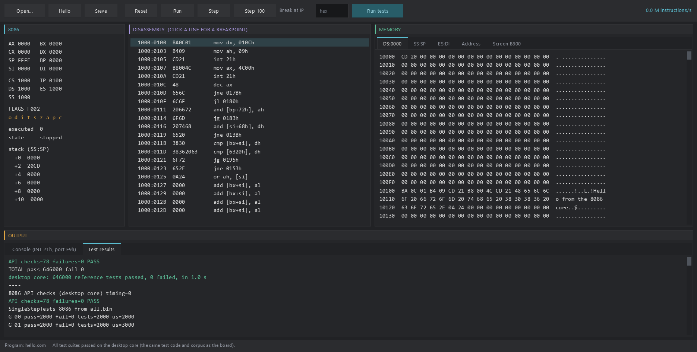

# The 8086 on the PC

The same Intel 8086 core as the Pico build, as a Windows program in PureBasic
(C back end, x64), drawn with the Neon Arcade Display Engine.



## Programs

| File | What it is |
|---|---|
| `cpu86_desktop.exe` | the window |
| `cpu86_console.exe` | the same program with a console: `--test`, `--bench`, `--run` |
| `cpu86_pc.exe` | the console program with the core counting 8086 clocks: the PC machine headless (`--pc`) |
| `cpu86_console_proctable.exe` | the console build on the procedure-table core (for the dispatch measurement) |

```text
cpu86_desktop.exe [program.com] [--run] [--show-tests] [--screenshot file.png]
cpu86_console.exe --test [stream]     the board's test suites (default ../Diagnostics/vectors-bin/all.bin)
cpu86_console.exe --bench             instructions per second, the Pico demo's mixes
cpu86_console.exe --run program.com   run a program, print its console output and exit code
cpu86_console.exe --com file [--seg hex] [--max n] [--dump file]
cpu86_console.exe --raw file --at linear --entry SEG:OFF [--max n] [--dump file]
```

`--com` / `--raw` is the runner for the PureMetal 8086 back end's gates: a bare CPU
with the whole 1 MB as RAM (no ROM, no BIOS, nothing in the vector table). `--com`
loads the file at SEG:0100 (SEG defaults to 0050) with CS=DS=ES=SS=SEG, IP=0100,
SP=FFFE; `--raw` loads it at a linear address and starts at SEG:OFF. OUT E9h prints
the byte to stdout; OUT F4h ends the run at once. It stops on HLT, on a jump to
itself (`EB FE`, `E9 FD FF`) or after `--max` instructions (default 10^9), then prints

```text
STOP exit=7|hlt|hlt (IF=1)|selfjump|budget instr=<n> ms=<t>
CS=.... DS=.... ES=.... SS=.... IP=.... SP=.... AX=.... BX=.... CX=.... DX=.... SI=.... DI=.... BP=.... FLAGS=....
```

and `--dump` writes the 1 MB raw. A self-jump is noticed between 10,000-instruction
slices, so its `instr=` includes the spinning. Exit code 0 when the run stopped, 2
with a sentence when the file could not be read or written. Test images:
`Diagnostics/gate/*.com`. Add `--pc` to run the file on the PC machine instead
(below; `cpu86_pc.exe` and `cpu86_desktop.exe` only, the clock-counted builds).

The window has a toolbar (Open, the two examples, Reset, Run/Stop, Step,
Step 100, a breakpoint at an IP, Run tests, and the speed), the registers and
flags with the top of the stack, a disassembly that follows CS:IP (click a line
to set or clear a breakpoint), a memory view (DS, SS:SP, ES:DI, any linear
address, and the CGA text screen at B800:0000), and an output pane with the
program's console and the test results.

## The machine

The full 1 MB is RAM except a 4 KB ROM at F000:0000 (`src/dosrom.pmi`, the same
bytes the Pico demo maps from flash) with a few DOS/BIOS services:

- INT 21h AH=02h (DL out), AH=09h (`$`-terminated string at DS:DX), AH=00h/4Ch (exit),
  INT 20h (exit), INT 10h AH=0Eh (AL out);
- port E9h out is the console, port EAh out ends the program with AL as its exit code.

A program (`.com`, or any raw binary) is loaded at 1000:0100 with its PSP at
1000:0000, CS=DS=ES=SS=1000h and SP=FFFEh, as DOS loads a .COM.
`examples/hello.com` and `examples/sieve.com` (primes below 10000: 1229) are
written by `tools/make_examples.py`.

## The PC machine

A minimal IBM PC with **no BIOS ROM**: the program brings its own vectors and drivers.
The same device code (`src/pc86.pmi`) runs here and on the Pico W (`src/pc.picow`).

```text
cpu86_pc.exe --com program.com --pc [--frames n] [--keys 1E,9E,..] [--screenshot file.png] [--halfcheck]
cpu86_desktop.exe program.com --pc --run       (the window: PC machine, PC screen tab, keys, speaker)
```

The program is loaded at **0050:0100** with CS=DS=ES=SS=0050, IP=0100 and SP=FFFE. Memory:

| Linear | What |
|---|---|
| 00000-9FFFF | RAM (640 KB); the vector table is empty |
| B8000-BBFFF | the CGA's 16 KB, mirrored at BC000-BFFFF |
| the rest | unmapped: reads FFh, writes ignored |

| Port | Device |
|---|---|
| 20h-21h | 8259 PIC: ICW1-ICW4, OCW1 mask, OCW2 EOI (non-specific 20h, specific 60h+n), OCW3 IRR/ISR read. Starts as a BIOS leaves it: vector base 8, IMR = FCh (IRQ0 and IRQ1 open) |
| 40h-43h | 8253 PIT: channels 0-2, modes 0-5 (1, 4 and 5 counted like 2), LSB/MSB/both, counter latch; no 8254 read-back. Channel 0 is IRQ0 and starts at 18.2 Hz (count 65536, mode 3); channel 2 is the speaker |
| 60h | keyboard: set-1 scan codes (make, then break), IRQ1; a read takes the code |
| 61h | bit 0 channel 2 gate, bit 1 speaker data, bit 7 keyboard acknowledge; reads bit 5 = channel 2's output |
| 3D0h-3D7h | 6845: index on the even ports, data on the odd ones (3D4h/3D5h); R12/R13 start address, R10/R11/R14/R15 cursor |
| 3D8h | CGA mode: text 40x25 / 80x25, 320x200x4, 640x200x2, blink, video enable |
| 3D9h | colour select: border/background, palette, intensity |
| 3DAh | status: bit 0 = outside the picture, bit 3 = vertical retrace, from the CPU's clock |
| E9h | out: a byte to stdout (the Pico: to its USB serial port) |
| F4h | out: ends the run, the value is the exit code |

The screen (window and `--screenshot`, 704 x 464) has a border: 32 pixels each side
and 16 scanlines above and below the picture, in the overscan colour of each scanline
as it begins ($3D9 bits 0-3; black in 640 x 200, where those bits are the foreground),
so raster effects on $3D9 show in it. `--keys` queues set-1 scan codes in hex.
`--halfcheck` also draws every line with the Pico's half-width renderer and counts the
lines where its pixel x differs from pixel 2x here (exit 4 if any).

No port 64h (that is the AT's controller), no DMA, no disks. Timing: 4.77 MHz,
304 clocks a scanline, 262 scanlines (200 in the picture, display enable for the
first 213 clocks of a line, vertical retrace on lines 224-239), 59.92 frames a
second; the PIT counts 76 per scanline. $3D8, $3D9 and the start address are read at
the start of each scanline, so a change made in a line's horizontal retrace shows
from the next line.

Checks (`desktop/examples`, made by `tools/make_examples.py`):

| Program | Result here |
|---|---|
| `pctest.com` | IRQ0 at 1 kHz counted over 7 vertical retraces: `R=7 T=115` (59.92 Hz frames); raster bars through all 16 colours, one per line |
| `keytest.com` | IRQ1 echoes every scan code: 6 of 6 |
| `beep.com` | PIT channel 2 through port 61h: 1000 Hz |
| `bars.com` | raster bars in the window, about 0.9x real time |
| `modes.com` | every mode with five colour selects, cursor, blink, start-address wrap; `--halfcheck`: 288,000 lines, 0 differing |

## The core and its dispatch

`cpu86_core.pbi` is written by `tools/gen_cpu.py` from the same handler text
as `src/cpu86.pico`, with 64-bit shift amounts for the flag tricks (the PC's
integers are 64 bits) and the computed jumps as C labels-as-values: a static
`void *` table of `&&ll_cpu86run_opXX` and `goto *` through PureBasic's inline C.
`cpu86_core_proc.pbi` is made from it by `tools/desktop_proc_variant.py`: the
same handlers, each a Procedure called through a table of procedure addresses.

Measured back to back on this PC (`docs/desktop-bench.log`, 100 x 1,000,000
instructions per mix):

| Mix | labels-as-values | procedure table |
|---|---:|---:|
| register / branch | **444 M instr/s** | 386 M |
| ALU | **490 M** | 300 M |
| memory | **232 M** | 160 M |
| call / stack | **348 M** | 226 M |
| `REP MOVSW` | **771 MB/s** | 589 MB/s |

Labels-as-values is faster on every mix (1.15x to 1.6x), so it is the default.

## Proof

The desktop runs **the board's own test code**: `Diagnostics/vectors_state.pmi`,
`vectors_run.pmi`, `api_state.pmi` and `api_checks.pmi` are included unchanged;
`tests.pbi` supplies only what the board gets from its USB port (the stream,
now read from a file written by `py -3 tools/vectors.py --out ...`).

| Check | labels-as-values | procedure table |
|---|---|---|
| SingleStepTests 8086 v1, all 646,000 tests | 646,000 pass (2.1 s) | 646,000 pass |
| API, interrupt and memory-map checks | 78 of 78 | 78 of 78 |
| `examples/sieve.com` | `primes below 10000: 1229`, exit 0 | |

Logs: `docs/desktop-test-full.log`, `docs/desktop-test-full-proctable.log`,
`docs/desktop-examples.log`. Screenshots (the window's own back buffer,
`--screenshot`): `docs/desktop-window-tests.png`, `docs/desktop-window-sieve.png`.

## Build

```powershell
.\desktop\build.ps1
```

PowerShell, `C:\Program Files\PureBasic\Compilers\pbcompilerc.exe`, x64,
`/THREAD /DPIAWARE /OPTIMIZER /CONSTANT GL_ENGINE_DIR$=C:/Users/ajtaj/Desktop/Neon-Arcade-Dispay-Engine/`.
It regenerates the cores and the examples first. The engine is not copied here.
